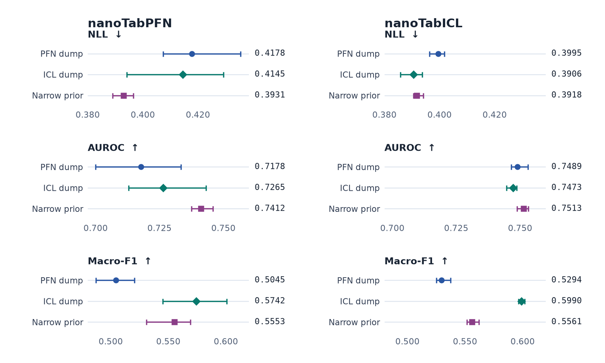

# Open Tabular Priors


Generate reproducible synthetic classification and regression episodes for
tabular in-context learning with NumPy or PyTorch.

## Install from PyPI

We recommend installing Open Tabular Priors from PyPI. Use Python 3.11 or later.

```sh
python -m pip install open-tabular-priors
```

For the PyTorch loader, install the `torch` extra.

```sh
python -m pip install "open-tabular-priors[torch]"
```

## Quickstart

```python
from open_tabular_priors import TrainingConfig, sample_episode

config = TrainingConfig(
    n_rows=120,
    n_features=8,
    n_classes=2,
    feature_types=("continuous",),
    width_modes=("direct",),
    class_logit_scale=1.2,
)
episode = sample_episode(config, seed=1729, index=0)
print(episode.X_context.shape, episode.X_query.shape)
```

Change `index` for another draw from the same seeded stream. Set
`n_classes=0` for regression.

## Training in stages

Start with narrow binary episodes, then give the same model a mix of narrow
and wider episodes. Keep the model and optimizer state across stages.

```python
from dataclasses import replace

from open_tabular_priors import TrainingConfig, TrainingMixture
from open_tabular_priors.torch import make_dataloader

simple = TrainingConfig(
    n_rows=120, n_features=8, n_classes=2,
    feature_types=("continuous",), width_modes=("direct",),
    class_logit_scale=1.2,
)
wider = replace(simple, n_features=(16, 32), width_modes=("wide",),
                wide_base_features=8)
stages = (simple, TrainingMixture((simple, wider), (1, 1)))


def scheduled_batches(seed=1729):
    episodes_per_stage = 256
    for stage, prior in enumerate(stages):
        yield from make_dataloader(
            prior, seed=seed, count=episodes_per_stage, batch_size=8,
            start_index=stage * episodes_per_stage,
        )


batch = next(iter(scheduled_batches()))
```

Pass `scheduled_batches()` to your training loop to consume both stages.
See the [prior recipes and training guide](docs/priors.md) for weighted mixes,
batching and more complex episodes.

## Evaluation



Points show means over three seeds and 30 binary TabArena-Lite development
tasks. Bars span the lowest and highest seed means.
All three training sources use 150 rows and five numerical features.
The narrow prior is the diverse 50/50 SCM/MLP mix.

## References

- Qu, J., Holzmüller, D., Varoquaux, G., and Le Morvan, M. (2025).
  *TabICL: A Tabular Foundation Model for In-Context Learning on Large Data.*
  ICML 2025, PMLR 267, 50817–50847.
  [Paper](https://proceedings.mlr.press/v267/qu25d.html) ·
  [TabICL v1 prior source](https://github.com/soda-inria/tabicl/blob/v0.1.3/src/tabicl/prior/dataset.py)
- Qu, J., Hudovernik, V., Jurkovič, M., et al. (2026).
  *NVIDIA Kumo Tabular: Pushing the Accuracy–Efficiency Frontier for Tabular
  Prediction.* arXiv:2611.23001.
  [Report and prior details](https://arxiv.org/html/2611.23001v1#A1)
- Hog, J., Mallik, N., Adriaensen, S., et al. (2026).
  *Towards Reliable Scaling Laws for Tabular Foundation Models.*
  arXiv:2611.24214. [Paper](https://arxiv.org/abs/2611.24214)

## License

Licensed under the [European Union Public Licence 1.2](LICENSE).
